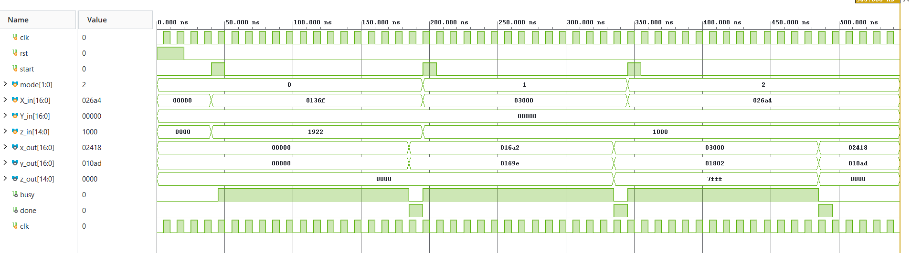

# CORDIC Processor in Verilog

This repository contains a compact, iterative CORDIC datapath written in Verilog. It performs circular, linear, and hyperbolic operations using a shared arithmetic core and a mode-selectable angle LUT.

The design is centered around `cordic_main`, with the angle constants stored in `cordic_angle`. A simple behavioral testbench drives the core and prints expected results for representative inputs.

| Mode | `mode` | Operation |
|------|--------|-----------|
| Circular | `2'd0` | Rotation / trigonometric compute: `cos z`, `sin z` |
| Linear | `2'd1` | Multiply: `y = x0 * z0` in fixed-point form |
| Hyperbolic | `2'd2` | `cosh z`, `sinh z` |

## Repository layout

```
Cordic algorithm/
├── README.md
├── Model/
│   └── Cordic_model.py
├── rtl/
│   ├── cordic_main.v
│   └── cordic_angle.v
├── tb/
│   └── tb_cordic_main.v
├── docs/
│   └── waveform.png

```

## CORDIC overview

The implementation uses the unified CORDIC update equations:

```text
x(i+1) = x(i) - m * d(i) * y(i) * 2^-i
y(i+1) = y(i) + d(i) * x(i) * 2^-i
z(i+1) = z(i) - d(i) * alpha(i)
```

where:

- `d(i) = +1` when the current angle is non-negative, otherwise `-1`
- `m = 1` for circular mode
- `m = 0` for linear mode
- `m = -1` for hyperbolic mode

The hyperbolic mode repeats the shift value `4` to satisfy the convergence condition.

## RTL modules

### `rtl/cordic_main.v`

This is the main iterative datapath.

Features:

- 2-bit `mode` input
- 14 iteration steps
- shared shift/add-subtract datapath
- `start`/`busy`/`done` handshake
- fixed-point arithmetic with right-shifted operands

### `rtl/cordic_angle.v`

This module generates the rotation constants (`alpha`) used for each iteration and mode. The selected values are hard-coded for the fixed-point format used in the design.

## Fixed-point format

The design uses signed fixed-point numbers as follows:

| Signal | Width | Interpretation |
|--------|-------|----------------|
| `X_in`, `Y_in`, `x_out`, `y_out` | 17 bits | signed, 1 sign + 3 integer + 13 fraction bits |
| `z_in`, `z_out` | 15 bits | signed, 1 sign + 1 integer + 13 fraction bits |

The scaling factor is `8192` (i.e. `2^13`), so a value of `1.0` is represented as `8192`.

## Example usage

The testbench in `tb/tb_cordic_main.v` exercises these cases:

1. Circular mode: `45°` input using `mode = 2'b00`
2. Linear mode: `1.5 * 0.5` using `mode = 2'b01`
3. Hyperbolic mode: `z = 0.5 rad` using `mode = 2'b10`

The expected values are printed and checked by eye in the testbench display messages.

## Simulation

A simple behavioral simulation can be run with `iverilog` when it is available:

```bash
cd "C:\Users\ACER\Desktop\Cordic algorithm"
iverilog -g2012 -o tb_cordic_main.out tb/tb_cordic_main.v rtl/cordic_main.v rtl/cordic_angle.v
vvp tb_cordic_main.out
```

This repository does not include a Tcl project generation script or a ready-made Vivado project. If you want to run it in Vivado, add the Verilog sources manually to a new project and simulate the testbench.

## Python model

The Python reference model is stored in:

```text
Model/Cordic_model.py
```

It implements the same fixed-point iteration logic as the RTL and can be used to compare outputs for validation.

## Waveform

A sample waveform screenshot is included here:



## Notes

- The design is iterative and reuses one datapath for all 14 iterations.
- `done` is asserted after the final iteration.
- The implementation is intended for fixed-point math, not floating-point operations.


